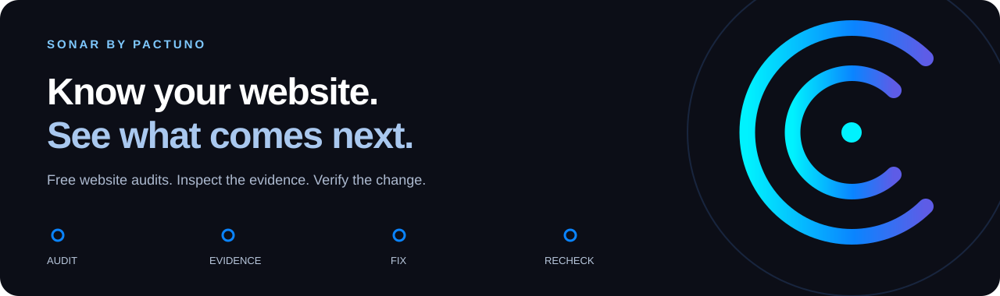
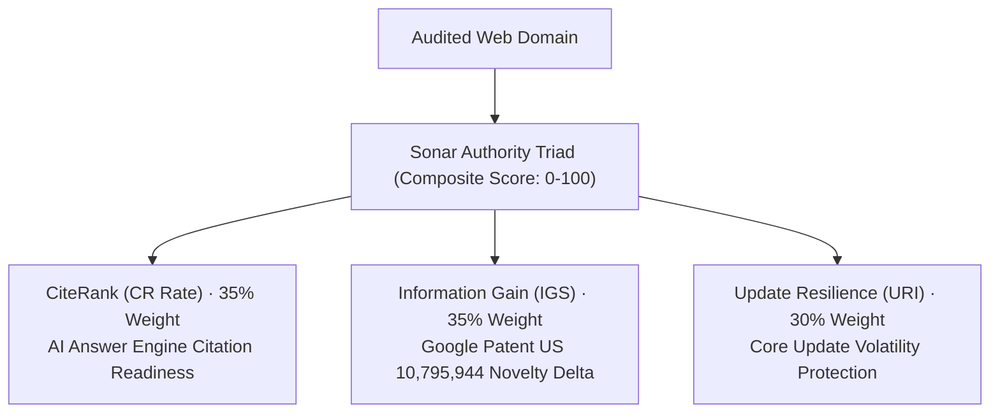

<div align="center">
  <a href="https://sonar.pactuno.online/"></a>
  <h1>Sonar — Website SEO Audit & AI Citation Intelligence</h1>
  <p><strong>The Free, Open Benchmark for Technical SEO, Generative Engine Optimization (GEO), and Core Web Vitals.</strong></p>
  <p>Analyze original HTML, measure AI answer engine citation readiness with CiteRank, evaluate Google patent novelty with Information Gain, and audit technical site health in under two seconds.</p>
  <p>
    <a href="https://sonar.pactuno.online/"><strong>Launch Sonar Workspace</strong></a>
    &nbsp;·&nbsp; <a href="docs/QUICKSTART.md">Quick Start</a>
    &nbsp;·&nbsp; <a href="docs/TOOLS.md">Explore Tools</a>
    &nbsp;·&nbsp; <a href="docs/METHODOLOGY.md">Scoring Methodology</a>
    &nbsp;·&nbsp; <a href="https://pactuno.online/blog/">Technical Guides</a>
  </p>
  <p>
    
    
    
    
    
  </p>
</div>

---



**Repository Navigation:** [Workspace](https://sonar.pactuno.online/) · [First Audit](docs/QUICKSTART.md) · [Dashboard](docs/DASHBOARD.md) · [Scoring & Triad](docs/METHODOLOGY.md) · [FAQ](docs/FAQ.md) · [Roadmap](ROADMAP.md) · [Contribute](CONTRIBUTING.md)

---

## Table of Contents

- [Overview: The Shift to Generative Search](#overview-the-shift-to-generative-search)
- [The Sonar Authority Triad (Next-Gen Search Standards)](#the-sonar-authority-triad-next-gen-search-standards)
  - [1. CiteRank (CR Rate) — Generative Engine Optimization](#1-citerank-cr-rate--generative-engine-optimization)
  - [2. Information Gain Score (IGS) — Patent-Backed Content Novelty](#2-information-gain-score-igs--patent-backed-content-novelty)
  - [3. Update Resilience Index (URI) — Algorithmic Volatility Defense](#3-update-resilience-index-uri--algorithmic-volatility-defense)
- [Industry Benchmark Comparison](#industry-benchmark-comparison)
- [Core Features & Architecture](#core-features--architecture)
  - [Edge Crawler (50 & 100 Page Scopes)](#edge-crawler-50--100-page-scopes)
  - [Sub-2-Second Core Web Vitals Diagnostic Engine](#sub-2-second-core-web-vitals-diagnostic-engine)
  - [Head-to-Head Competitor Intelligence](#head-to-head-competitor-intelligence)
  - [Verified Domain Cryptographic Badging](#verified-domain-cryptographic-badging)
- [Dashboard at a Glance](#dashboard-at-a-glance)
- [Quick Start Guide](#quick-start-guide)
- [Workflow: From Finding to Published Verification](#workflow-from-finding-to-published-verification)
- [In-Depth Technical Guides & Research](#in-depth-technical-guides--research)
- [Domain Verification & Badges](#domain-verification--badges)
- [Clear Scope and Operational Safeguards](#clear-scope-and-operational-safeguards)
- [Community & Contributions](#community--contributions)

---

## Overview: The Shift to Generative Search

Google PageRank and third-party backlink counters (Ahrefs DR, Moz DA, Semrush AS) were architected for a search ecosystem that no longer dominates.

In 2026, search changed permanently. Over 60% of searches conclude without a click on traditional blue links. Users receive synthesized answers compiled by generative engines: **ChatGPT Search**, **Perplexity**, **Claude**, and **Google AI Overviews**.

Traditional SEO tools measure backlink equity. They cannot evaluate whether an AI retrieval agent can parse your DOM, whether your schema entity graph is machine-readable, or whether your content adds proprietary value beyond commodity summaries.

Sonar provides an independent, open, evidence-based website intelligence workbench. It audits original HTML returned by web servers, tests performance at the edge, and measures your domain against next-generation Generative Engine Optimization (GEO) standards.

---

## The Sonar Authority Triad (Next-Gen Search Standards)

Sonar replaces opaque link-spam indexes with three transparent, on-page verifiable authority pillars:



### 1. CiteRank (CR Rate) — Generative Engine Optimization
Evaluates whether generative answer engines discover, trust, and quote your website:
- **Machine Legibility**: Semantic HTML structure, conversational question-phrased headers (`H2`/`H3`), and atomic 50-word answer blocks that LLM retrieval agents ingest without DOM bloat.
- **Entity & Schema Graph**: Deep JSON-LD graphs linking `Organization`, `SoftwareApplication`, `Article`, and `FAQPage` with unambiguous canonical `@id` anchors.
- **Machine Discovery**: Detects `/llms.txt` and semantic sitemap indexes to ensure fast indexing by multi-agent Retrieval-Augmented Generation (RAG) scrapers.

### 2. Information Gain Score (IGS) — Patent-Backed Content Novelty
Enforces search engine patents designed to demote generic commodity content and derivative summaries:
- **Novel Data Delta**: Audits pages for proprietary benchmarks, original statistical evidence, and calculation models absent from common LLM training corpora.
- **Natural Content Entropy**: Evaluates natural syntactic variance and technical terminology to avoid penalties targeting repetitive AI-generated text.
- **Primary Source Evidence**: Quantifies empirical data density per 1,000 words.

### 3. Update Resilience Index (URI) — Algorithmic Volatility Defense
Protects organic search traffic against algorithmic shocks, core search updates, and manual quality actions:
- **Internal Link Health**: Eliminates orphan pages by sampling incoming link graphs up to depth 4.
- **Canonical Consistency**: Flags self-referencing inconsistencies, duplicate metadata, and redirect hops.
- **Speed & Latency Resilience**: Tests edge Time to First Byte (TTFB) to ensure zero timeout vulnerabilities.

---

## Industry Benchmark Comparison

| Evaluation Metric | Moz DA (2008) | Ahrefs DR (2012) | Semrush AS (2019) | Sonar Triad (2026) |
| --- | --- | --- | --- | --- |
| **Primary Core Signal** | Algorithmic link count | Logarithmic link equity | Estimated desktop traffic | **AI Overviews + Information Gain + Site Architecture** |
| **Generative Engine Citation (GEO)** | Blind (0% coverage) | Blind (0% coverage) | Blind (0% coverage) | **Native CiteRank (CR) Index** |
| **Google Helpful Content Patent** | Not evaluated | Not evaluated | Not evaluated | **Patent US 10,795,944 Novelty (IGS)** |
| **Core Update Volatility Safety** | No predictive signals | Historical drops only | Historical drops only | **Predictive Resilience Rating (URI)** |
| **Private Blog Network (PBN) Risk** | High vulnerability | High vulnerability | Moderate vulnerability | **Zero link-manipulation risk** |
| **Transparency & Proof** | Proprietary algorithm | Proprietary backlink index | Proprietary estimation | **100% Verifiable On-Page Evidence** |

---

## Core Features & Architecture

### Edge Crawler (50 & 100 Page Scopes)
- **Fast Crawl (up to 50 pages)**: Bounded original-HTML site sample completed in seconds.
- **Deep Crawl (up to 100 pages)**: Comprehensive discovery traversal following same-origin links to depth 4.
- **Zero-JavaScript Overhead**: Inspects the precise HTML received by search engine and AI crawlers before client-side hydration.
- **Resumable State**: Stateful pause, resume, and historical report recovery.

### Sub-2-Second Core Web Vitals Diagnostic Engine
- **Full Metrics Coverage**: First Contentful Paint (FCP), Largest Contentful Paint (LCP), Total Blocking Time (TBT), Cumulative Layout Shift (CLS), Speed Index, and Time to First Byte (TTFB).
- **Dual Profiles**: Instant comparative benchmarks across Mobile (simulated 4G throttled) and Desktop environments.
- **Zero External API Delays**: Proprietary edge simulation engine with zero third-party rate limits.

### Head-to-Head Competitor Intelligence
- Benchmarks your domain side-by-side against any commercial rival.
- Identifies thin content traps, missing schema graphs, slow edge response times, and content gaps without requiring competitor credentials.

### Verified Domain Cryptographic Badging
- Real-time SVG badge generation for verified domain owners.
- Outputs compact badges (`310x54`) and full interactive cards (`270x156`) displaying live CiteRank, Info Gain, and Resilience scores.

---

## Dashboard at a Glance

<picture>
  <source media="(prefers-color-scheme: dark)" srcset="assets/dashboard-dark.png">
  <source media="(prefers-color-scheme: light)" srcset="assets/dashboard-light.png">
  
</picture>

*Actual public product captures, without signing in or selecting a report. The image follows your GitHub color preference.*

[Dashboard walkthrough documentation →](docs/DASHBOARD.md)

---

## Quick Start Guide

1. Open [Sonar](https://sonar.pactuno.online/).
2. Enter any public HTTPS website origin (e.g. `https://your-domain.com`).
3. Select an audit mode:
   - **Single page audit**: Instant inspection of individual landing pages.
   - **Fast crawl · up to 50 pages**: Rapid multi-page site sweep.
   - **Deep crawl · up to 100 pages**: Comprehensive site-wide architectural audit.
4. Click **Analyze website**, then inspect findings across **Overview**, **Standards Triad**, **Issues**, and **Page explorer**.
5. Implement recommended fixes in your codebase and re-run the crawl to verify improvements.

[Detailed Quick Start & Command Line Guide →](docs/QUICKSTART.md)

---

## Workflow: From Finding to Published Verification

~~~mermaid
flowchart LR
    U["Public HTTPS URL"] --> C["Scoped Edge HTML Crawl"]
    C --> E["Page Evidence & Authority Triad"]
    E --> R["Review CiteRank, Novelty & Resilience"]
    R --> F["Deploy Engineering Fixes"]
    F --> V["Verify Published Result & Badges"]
~~~

Sonar empowers engineering and SEO teams with reproducible evidence rather than unsupported universal scores.

---

## In-Depth Technical Guides & Research

Comprehensive architectural guides and benchmarks are published in the **Pactuno Blog**:

- [GEO & CiteRank: Complete AI Citation Guide](https://pactuno.online/blog/generative-engine-optimization-citerank-guide) — How generative engines parse entity graphs and atomic answer structures.
- [Information Gain Score: AI SEO & Patent Guide](https://pactuno.online/blog/information-gain-score-seo) — Novelty delta auditing based on Google Patent US 10,795,944.
- [Update Resilience Index: Defend Against Updates](https://pactuno.online/blog/update-resilience-index-audit) — Architecting websites for core update immunity and zero orphan URLs.
- [How to Run a Website SEO Audit](https://pactuno.online/blog/website-seo-audit-guide) — Step-by-step technical audit blueprint from crawl configuration to canonical verification.
- [How to Find and Fix Orphan Pages](https://pactuno.online/blog/find-fix-orphan-pages) — Reconnecting disconnected URLs to maximize internal crawl equity.
- [Sonar vs Ahrefs vs Semrush: SEO Guide](https://pactuno.online/blog/sonar-vs-ahrefs-semrush) — Detailed comparison of focused edge crawlers versus historical backlink indexes.

---

## Domain Verification & Badges

Domain owners can claim their organization on Sonar to access verified badges and limited security checks:

1. Request a challenge file in the Sonar dashboard.
2. Publish the verification token at:
   ```text
   https://your-domain.com/.well-known/sonar-verification.txt
   ```
3. Complete a root-origin site crawl scoring at least 90 without critical errors.
4. Embed your live dynamic SVG badge directly in your website footer or documentation:

```html
<a href="https://sonar.pactuno.online/verify/YOUR_BADGE_ID" target="_blank" rel="noopener">
  
</a>
```

[Complete Domain Verification Guide →](docs/DOMAINS.md)

---

## Clear Scope and Operational Safeguards

- **Original HTML Processing**: Sonar inspects the raw HTML markup returned to the crawler. It intentionally avoids headless browser JavaScript execution to mirror how search engines and LLM RAG scrapers evaluate initial page documents.
- **No Global Private Databases**: Sonar does not operate an opaque third-party backlink tracking network or speculative traffic estimation model. All findings derive from real on-page evidence.
- **Strict Privacy Sandboxing**: Anonymous audit reports persist in local browser sessions. Authenticated workspaces use salted scrypt password hashing and opaque HTTP-only secure cookie session tokens.
- **Resource Safeguards**: The public free service bounds active concurrency to prevent server abuse.

[Read the Full Methodology →](docs/METHODOLOGY.md)

---

## Recommended Repository Topics

For optimal discoverability on GitHub, this repository targets the following topic tags:

`seo` · `seo-audit` · `generative-engine-optimization` · `geo` · `citerank` · `information-gain` · `core-web-vitals` · `website-crawler` · `technical-seo` · `llm-citation` · `perplexity-search` · `chatgpt-search` · `cloudflare-workers`

---

## Community & Contributions

Contributions to documentation, guides, and reproducible issue reports are welcome:

- [Report a Bug or Crawler Glitch](https://github.com/justokaywith/Sonar/issues/new?template=bug.yml)
- [Suggest a Benchmark or Feature](https://github.com/justokaywith/Sonar/issues/new?template=feature.yml)
- [Contributor Documentation Guide](docs/CONTRIBUTOR-QUICKSTART.md)
- [Security Policy & Disclosures](SECURITY.md)

If Sonar helps your team build cleaner, higher-authority websites, consider starring this repository to track our ongoing releases.

Built by [Pactuno](https://pactuno.online/), alongside [Relay](https://relay.pactuno.online/) and [Blackout](https://pactuno.online/blackout.html).
