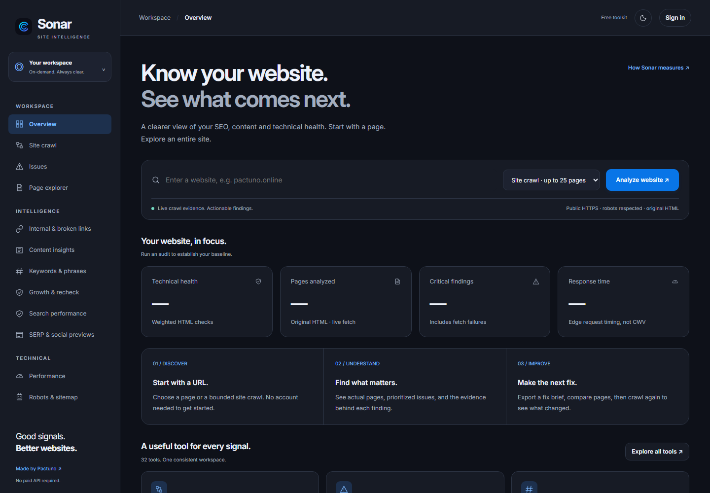

<h1 align="center">Sonar</h1>

Know your website. See what comes next.

<a href="https://sonar.pactuno.online/">Open Sonar</a> · <a href="docs/QUICKSTART.md">Quick start</a> · <a href="docs/TOOLS.md">Tool guide</a> · <a href="CONTRIBUTING.md">Contribute</a>

Sonar is a free, on-demand website audit and SEO workbench by Pactuno. Start with a URL, inspect real evidence, plan improvements, and recheck what changed. No paid API key is needed.

## Start in one minute
1. Open [Sonar](https://sonar.pactuno.online/).
2. Enter a public HTTPS website. Choose a single page or a site crawl.
3. Open **Issues** to see affected pages, evidence and a repair guide.
4. Use **Growth & recheck**, then export a fix brief or compare the next audit.

Basic audits work without signing in. Sign in with a verified Pactuno account to keep reports across sessions. Domain connections, security checks and badges require a matching verified business email and domain-control proof.

## What you can do
- Crawl up to 25 original-HTML pages per run, within a bounded report budget; pause, resume or cancel.
- Inspect titles, descriptions, headings, canonical tags, indexing signals, images, structured-data syntax, links and selected response headers.
- Explore duplicate metadata, internal-link graphs, orphan candidates and keyword-overlap candidates.
- Get page-specific repair steps, keyword/topic drafts and a practical traffic-improvement plan.
- Recheck a page against an owned baseline, including new/resolved findings and HTML changes.
- Import Search Console CSV locally for measured clicks, impressions, CTR and position.
- Request Google PageSpeed measurements; unavailable data stays explicitly unavailable.
- Review limited owner-authorized security signals and known dependency advisories through OSV.
- Analyze access logs locally with masked IPs and redacted query strings.
- Earn a dated, expiring, publicly verifiable 90+ score badge after business/domain verification.

See [all tool groups and limits](docs/TOOLS.md) and [how scoring works](docs/METHODOLOGY.md).

## Connected organizations and reclaim
A registrable domain can belong to one organization administrator at a time. Pending verification does not reserve it. Another claimant sees:

> Someone in your organization has already claimed this domain on Sonar. Reach out to your company admin for more information.

If that administrator has left, open **Verified score badge → Has your company administrator left?** Prepare a request to **support@pactuno.online**, subject **Reclaim domain - {domain name}**, and send it from the matching company email. Support manually checks authority and domain control. [Full process](docs/DOMAINS.md).

## Clear scope
Sonar is an accessible alternative for focused technical audits, not feature or dataset parity with Ahrefs or Semrush. It has no global backlink index, keyword-volume database, competitive traffic estimates or continuous attack monitoring. HTML crawls do not execute page JavaScript. Security signals are not a penetration test or proof that no breach occurred. [Methodology and privacy](docs/METHODOLOGY.md).

## Screenshots

Light workbench

Screenshots are actual product captures. Empty-state dashboards deliberately show no invented metrics.

## About this repository
This public repository contains documentation, examples and product references. The hosted application's source and infrastructure remain private. Contributions should improve guides, accessibility feedback, integration examples and reproducible bug reports; do not submit application source, credentials or customer data.

- [Contributing](CONTRIBUTING.md)
- [Security reporting](SECURITY.md)
- [Code of conduct](CODE_OF_CONDUCT.md)
- [Documentation/example license](LICENSE)

Built by [Pactuno](https://pactuno.online/), alongside [Relay](https://relay.pactuno.online/) and [Blackout](https://pactuno.online/blackout.html).
