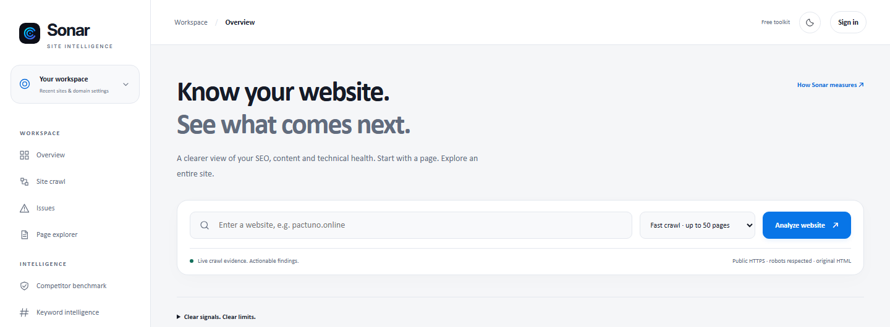

# Dashboard walkthrough

The [hosted workspace](https://sonar.pactuno.online/) is the application. GitHub contains documentation and examples, not your account dashboard.

## Start an audit

The URL field and scope selector sit above the report area. **Analyze website** starts the selected job. A report's scope, state and date matter when comparing results.

*Captured without an account or selected report. No fictional measurements.*

## Read the workbench by task

| Area | Start here when you want to… |
| --- | --- |
| Overview / Site crawl | See the current sample and crawl progress. |
| Issues | Find an affected page and understand a check. |
| Page explorer | Inspect an individual page's observed evidence. |
| Intelligence tools | Review supported page comparisons, content/keyword heuristics, link architecture and growth suggestions. |
| Search performance | Analyze authorized search data; distinguish imports from a configured live connection. |
| Performance | Examine supported performance evidence separately from crawler timing. |
| Robots & sitemap | Check discovery and crawl directives. |
| HTTP & security | Inspect selected response and HTTPS signals. |
| Owner security checks | Run the limited, explicitly authorized checks for an eligible connected domain. |
| Security logs | Review supported local log heuristics without posting raw logs publicly. |
| All tools / Crawl history | Find a capability or return to an owned report. |
| Verified score badge | Review business-domain verification and public badge eligibility. |

Labels and grouping can change as the product evolves. A menu item is not a promise of an external dataset or a configured provider.

## Account and domain controls

**Sign in** opens Sonar's own username/email/password flow. Business claims require a matching verified company mailbox and proof of domain control.

[First audit](QUICKSTART.md) · [Evidence and limits](METHODOLOGY.md) · [Domain guide](DOMAINS.md)
