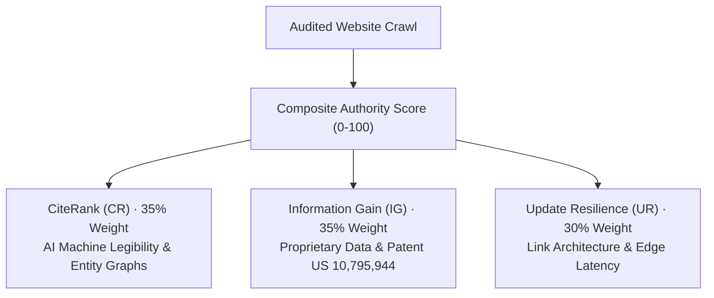

# Evidence, Score and Methodology

Sonar reads original returned HTML and selected public response signals. It does not execute the target website's JavaScript, mirroring how high-efficiency search engine crawlers and Retrieval-Augmented Generation (RAG) scrapers evaluate document semantics. A report describes the pages actually fetched, not every page that might theoretically exist.

---

## 1. Technical Health Score

Each check applied to an audited page has a weighted value:

- **Pass**: Earns 100% of available weight.
- **Notice**: Earns 70% of available weight.
- **Warning or Error**: Earns 0% weight.
- **Failed HTTP Fetch (4xx / 5xx)**: Page score defaults to zero.

A page score is calculated as `100 * (earned weight / available weight)`. The site score represents the rounded average of fetched page scores across the crawl sample. Pages are normalized independently.

The technical health score evaluates verifiable on-page hygiene, structured schema syntax, indexability directives, and metadata completeness. It is not an arbitrary ranking prediction or a security penetration certification.

[Public scoring explanation on Sonar](https://sonar.pactuno.online/methodology/)

---

## 2. Sonar Global Authority Standards Triad

In addition to checklist hygiene, Sonar evaluates domains against the Authority Standards Triad, replacing 2012-era link-counting proxies with Generative Engine Optimization (GEO) metrics:

### A. CiteRank (CR Rate) — 35% Weight
Measures whether generative answer engines (ChatGPT Search, Perplexity, Gemini, Claude, and Google AI Overviews) discover, trust, and cite your pages:
- **AI Machine Legibility**: Clean DOM-to-text ratios, logical heading hierarchies, and atomic Q&A structures (50-word answers beneath question-form headers).
- **Entity & Schema Graph**: Depth and correctness of Schema.org JSON-LD graphs linking `Organization`, `SoftwareApplication`, and `Article` entities.
- **Conversational Format**: Direct step-by-step resolution formats suitable for conversational LLM synthesis without hallucination.

### B. Information Gain Score (IGS) — 35% Weight
Measures content novelty against Google Patent US 10,795,944 ("Information Gain Score"):
- **Novel Data Delta**: Detection of proprietary calculations, empirical benchmarks, and original research absent from common LLM training corpora.
- **Content Entropy**: High natural lexical variance that distinguishes original technical writing from repetitive synthetic AI output.
- **Primary Source Evidence**: Real factual claims and verifiable references per 1,000 words.

### C. Update Resilience Index (URI) — 30% Weight
Measures architectural immunity against search engine core updates and volatility:
- **Internal Link Equity**: Clean link graph traversal with zero orphan pages in the crawl sample.
- **Canonical Hygiene**: Absolute canonical tags with zero self-referencing loops or protocol mismatches.
- **Edge Latency Velocity**: Sub-100ms Time to First Byte (TTFB) ensuring zero timeout drops during algorithmic indexing crawls.

---

## 3. Crawl Scope & Discovery

Sonar offers three audit modes:
- **Single Page Audit**: Deep inspection of an individual URL.
- **Fast Crawl (up to 50 pages)**: Rapid multi-page site sweep for standard business sites.
- **Deep Crawl (up to 100 pages)**: In-depth architectural crawl following internal links up to depth 4.

Site discovery is bounded by depth limits, `robots.txt` directives, payload budgets, and shared edge capacity. Closing the browser tab pauses client-driven crawl execution.

---

## 4. Distinct Evidence Boundaries

To maintain rigorous transparency, Sonar isolates different data sources:
- On-page word frequency is not search volume.
- Keyword overlap is not proven cannibalization.
- Content publication age is not traffic decay.
- Crawler edge response time is distinct from Google Core Web Vitals.
- Authorized Google Search Console data describes only the authenticated property and selected date range.
- PageSpeed and Core Web Vitals evidence must derive from official measurement engines. Unavailable data is reported honestly rather than synthesized.

---

## 5. Domain Verification & Authority Badges

An eligible badge requires:
- A completed root-site crawl scoring at least 90 without critical errors.
- A verified business email domain matching the audited origin.
- Current domain-control proof via `/.well-known/sonar-verification.txt`.
- Active organization-administrator ownership.

Badges expose live verification records disclosing the origin, score, sample size, and scan timestamps. They expire after 60 days to ensure data freshness.

Badges represent an automated technical audit of sampled pages; they are not an independent security certification, financial rating, or guarantee against malicious intrusion.

---

## 6. Security Inspection Scope

Owner-authorized security checks evaluate public HTTP response headers, HTTPS configuration, transport policies, and exposure of known static paths. These checks do not execute penetration attacks, credential stuffing, or intrusive payload injection.

Supported package vulnerability lookups utilize OSV databases. Local log heuristics provide administrative diagnostics and do not constitute legal breach forensics.
